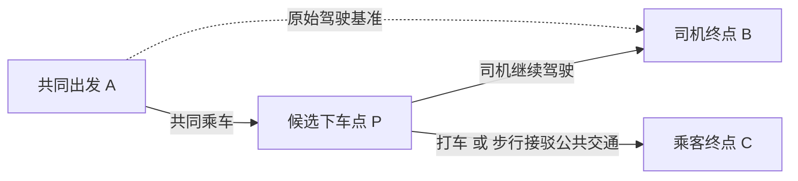
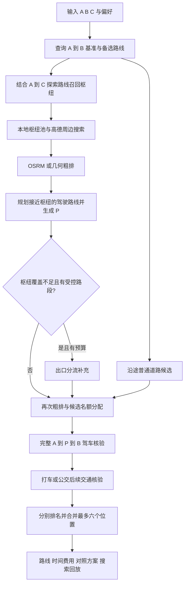

# 顺路下车 · AlongRoute

一个用于“司机尽量少绕路、乘客中途下车后选择打车或公共交通”的 **Web/H5 MVP**，支持 Windows 本地开发和 Linux 服务器部署。

**当前方案：枢纽优先召回 + 沿途普通道路补充 + 可选 OSRM 批量粗排 + 高德完整路线核验 + 三档偏好排名 + 同点位打车/公交协同推荐。** 本文按 2026-11-10 的代码实现整理；历史设计与改造记录中的旧参数，以本文和当前代码为准。

> 当前项目包含演示模式和高德路线数据接入，不是生产级安全上下客点数据库。**所有真实 POI 都标记为待核实，不能据此确定可停车。严禁在高速主线、匝道等禁停路段上下车。**

## 已包含的功能

- Vue 3 + TypeScript + Vite 响应式网页（桌面 / 手机）
- A 共同出发地、B 司机终点、C 乘客终点的地点搜索和选择
- 司机最多增加 0–180 分钟（默认 180 分钟）、乘客打车预算 0–200 元（默认 200 元）；支持打车/公交，时间/费用/均衡偏好同时作用于两种方式
- FastAPI 后端 API 和 Swagger 文档
- 无 Key 即可浏览的 **虚构演示模式**（全部价格和时间均为模拟数据）
- 高德 Web 服务 Key 接入后：地点 POI 搜索（含公交所需城市编码）、沿途道路及停车场候选、公交/地铁站周边候选、司机连续途经路线验证、打车与公交方案；打车综合比较司机增加时间、乘客全程时间与车费，公交按乘客全程耗时和偏好推荐，返回最多 6 个候选
- 公共交通下车点到实际乘车站台或地铁入口的步行路径不超过 300 米，显示到站步行、公交全程步行、共同乘车时间及预计到达时间
- 推荐卡片显示司机完整 A→P→B 总时间（含停靠）；同点位存在合格打车和公交方案时，可调整主推方式，并在推荐理由中显示另一方式的时间、费用及公交到站步行距离
- 有效 Key + 前端 JS API Key + JS 安全密钥时：高德地图真实展示；无地图 Key 时显示示意路线
- 演示数据与真实数据均强制显著标注；真实候选均 **unverified / 待核实**
- 手动指定下车点测算、司机与乘客行程明细、按搜索编号查看候选筛选过程
- 后端测试、Windows PowerShell 安装与启动脚本、Linux 部署脚本、Key 占位配置

**快速查看界面：** 在 Windows 上直接双击项目根目录的 `preview.html`，无需 Node.js、Python 或 Key。它是独立的模拟交互预览，不调用真实地图。

## 方案解决什么问题

共同出发点是 **A**，司机目的地是 **B**，乘客目的地是 **C**。系统寻找中途下车点 **P**：司机走 A→P→B，乘客先随车走 A→P，再从 P 打车或乘公共交通到 C。

需要同时比较三个因素：司机多花多少时间、乘客从出发到抵达总共花多少时间、乘客下车后花多少钱。例如，继续坐车可以降低打车费，但也可能让司机绕路、让乘客更晚到家；较早在地铁入口附近下车，虽然离 C 更远，反而可能更快。因此，单看“离原路线最近”或“离 C 最近”都不足以完成推荐。

当前实现采用有预算的候选搜索：先找到值得核验的区域和道路位置，再用真实路线数据检查限制，最后按交通方式排名。核心决策由固定规则、路网估算和评分公式完成，当前规划链路没有调用大语言模型。它用于**出发前规划**，尚未接入车辆实时定位。



## 系统如何分工

| 层次 | 实现 | 主要职责 |
|---|---|---|
| 页面与地图 | Vue 3、TypeScript、Vite、高德 JS API | 输入地点和限制，展示路线、时间费用、乘坐步骤与候选回放 |
| API 与任务管理 | FastAPI、Pydantic | 校验参数、区分演示/真实模式、处理取消和超时、关联搜索日志 |
| 候选发现 | 枢纽搜索、普通道路采样、出口分流补充 | 产生有限且分散的候选，尽量覆盖不同方向、区域和交通方式 |
| 粗排 | 可选 OSRM；失败时几何估算 | 估计哪些位置值得优先精算，控制后续地图请求规模 |
| 正式核验 | 高德驾车、公交、步行接口 | 核验完整司机路线、乘客后续交通、到站步行及各项硬约束 |
| 排名 | `optimizer.py` | 打车综合评分、公交偏好排序、去除全面更差的候选、合并展示 |
| 本地存储 | SQLite 与 JSONL 文件 | 缓存地图响应、积累枢纽候选、保留诊断和回放记录 |

开发时，浏览器访问 Vite 的 5173 端口，`/api` 和 `/_AMapService` 被代理到 8000 端口的后端。Linux 部署时，生产入口默认在 8080 端口同源提供前端静态文件与 API。高德 Web 服务 Key 和 JS 安全密钥由后端持有；浏览器只使用公开的 JS API Key。

## Linux 服务器部署

在服务器普通 SSH 终端运行 `bash scripts/deploy-linux.sh`，默认监听 `0.0.0.0:8080`，构建前端并注册开机自启服务。缺少地图Key时使用演示模式。详细步骤与维护命令见 [Linux部署说明](docs/DEPLOY_LINUX.md)。

## 一、Windows 安装运行

已验证的用户环境：Windows PowerShell、Node.js v24.15.0、npm 11.12.1、Python 3.11.5、Git 2.33.1。

1. 解压本工程到如 `D:\Projects\AlongRoute` 或 `C:\Users\pc\Projects\AlongRoute`。
2. 在项目目录打开 PowerShell：

```powershell
cd "D:\Projects\AlongRoute"  # 按实际解压位置修改
powershell -ExecutionPolicy Bypass -File .\setup-windows.ps1
```

脚本将创建独立的 Python `.venv`、安装依赖、生成空白 Key 配置文件。**无需使用 `py`，也无需退出你的 Conda base 环境**。

3. 打开两个 PowerShell 窗口，分别执行：

**终端 1**

```powershell
powershell -ExecutionPolicy Bypass -File .\start-backend.ps1
```

**终端 2**

```powershell
powershell -ExecutionPolicy Bypass -File .\start-frontend.ps1
```

4. 打开 http://127.0.0.1:5173/。FastAPI 文档在 http://127.0.0.1:8000/docs。

**不配置高德 Web 服务 Key 也能看到完整的交互演示**；此时不会发起真实路线规划。

## 二、仅由你本人完成的高德 Key 配置

详细步骤：[`docs/AMAP_KEYS_ONLY_YOU.md`](docs/AMAP_KEYS_ONLY_YOU.md)。

- `backend/.env` → `AMAP_WEB_SERVICE_KEY=...` （真正查询路线和地点）
- `backend/.env` → `AMAP_JS_SECURITY_CODE=...`（后端存放 JS 安全密钥）
- `frontend/.env.local` → `VITE_AMAP_JS_KEY=...`（前端公开的 JS API Key）

**不要将真实 Key 发送给任何聊天助手，或推送至 GitHub。** 提供的 `.gitignore` 已覆盖上述文件。

填好后重启前后端。Key 配置完成时，地图调用会产生真实配额消耗；实际公交换乘还依赖从高德地点搜索返回的 citycode。

## 三、API

| 方法 | URL | 说明 |
|---|---|---|
| GET | `/api/health` | 服务健康检查 |
| GET | `/api/config` | `demo` / `live` 模式和 JS 代理可用性 |
| GET | `/api/places/suggest?q=广州塔` | 地址建议（demo 返回少量演示 POI） |
| POST | `/api/recommend` | 自动计算并排序下车点候选 |
| POST | `/api/evaluate-dropoff` | 测算用户指定的 P，超限仍展示 |
| GET | `/api/search-replay/{search_id}` | 读取一次自动规划的候选回放 |
| GET | `/docs` | Swagger/OpenAPI |

API 详细请求见 [`docs/API.md`](docs/API.md)。自动推荐响应中，最常用的字段如下：

| 字段 | 读取方式 |
|---|---|
| `baseline_route` | 原始 A→B 驾驶路线，作为司机时间和里程的对照 |
| `recommendations[].point` | 用于正式算路的下车位置 P，与地图标记一致 |
| `driver_route` / `driver_detour_s` | 完整经停驾驶路线 / 含停靠的司机增加秒数 |
| `shared_ride_s` / `stop_duration_s` | A→P 共同乘车秒数 / 停靠秒数 |
| `options[]` | 该位置可用的打车或公交选项及时间、费用、行程详情 |
| `options[].boarding_stop` / `boarding_walk_m` | 公交实际首乘入口或站台 / 已核验的到站步行距离 |
| `stop_status` | 真实自动候选为 `unverified`，表示停靠条件待核实 |
| `comparisons` | 取得的直接出行、随车到 B 后出行对照 |
| `search_id` / `warnings` | 日志编号 / 数据缺失、预算和边界提示 |
| `search_complete` / `examined_candidates` | 搜索完整性标志 / 已启动精算的候选数，详见 4.11 |
| `departure_at` / `generated_at` / `expires_at` | 出发时刻 / 结果生成时刻 / 提示重算时刻 |

表中未带完整前缀的候选字段位于 `recommendations[]` 内；距离以米、耗时以秒、费用以元表示。

## 四、当前选点与推荐方案详解

### 4.1 输入、参数与时间口径

A、B、C 都应从地点搜索结果中选择，以取得坐标和公共交通需要的 `citycode`。所有业务地点使用高德 GCJ-02 坐标，经度 `lon` 在前、纬度 `lat` 在后。手动测算额外需要一个 P。

| 参数 | 当前默认值 / 范围 | 实际含义 |
|---|---|---|
| `max_detour_minutes` | 默认 180，0–180 分钟 | 司机相对原路线增加的总时间，**包括停靠** |
| `max_taxi_fare_yuan` | 默认 200，0–200 元 | P→C 的出租车估价上限，不限制公交票价 |
| `modes` | 默认 `taxi`、`transit` | 至少选择一种后续交通方式 |
| `priority` | 默认 `balanced`；另有 `time`、`cost` | 控制打车三档权重、公交偏好及同点位主推方式，详见 4.10 |
| `max_walking_m` | 默认 1200，0–5000 米 | 公交全程步行，包括到站、换乘及末段步行 |
| `max_transfers` | 默认 2，0–8 次 | 公交/地铁换乘次数上限 |
| `departure_time` | 可省略 | 省略则取当前中国时间；无时区输入按中国时间解释 |
| 到实际首乘站的步行上限 | 固定 300 米 | 独立于全程步行上限，不可通过提高 `max_walking_m` 放宽 |

以上范围是后端模型允许的范围。公交按预计抵达 P 并停靠结束的时刻查询；驾驶时间按查询时取得的地图估算处理，不代表已接入未来出发时刻的交通预测。

### 4.2 一次自动推荐的整体流程



其中“召回”是找出可能有价值的位置，“粗排”是决定先算哪些位置，“精算”是调用正式路线接口检查限制。前两个阶段的估计不能直接成为正式推荐。由于名额和时间有限，粗排仍会影响哪些候选最终有机会接受核验，因此它不是无损的全量搜索。

### 4.3 第一步：建立统一司机基准

查询高德 A→B 驾车路线，从解析到的最多三条路线中选耗时最短的一条作为基准 `T_base`。所有候选都与这条基准比较，不因换了一条探索路线就放宽司机增加时间。

用于发现候选的其他 A→B 路线，还必须满足：

```text
备选路线耗时 ≤ T_base + max(0, 司机增加时间上限 − 10 分钟)
```

这给接近下车点、停靠和继续去 B 留出探索余量。例如上限为 30 分钟，备选路线最多比基准慢 20 分钟；上限不超过 10 分钟时，只保留与最快路线同耗时的路线。这是**探索路线的筛选规则**，具体 P 最终仍使用用户填写的完整上限核验。

另外查询最多两条 A→C 路线，用来发现朝乘客目的地方向的枢纽和道路。它们不会替代司机基准，也不要求司机最终沿 A→C 行驶。

### 4.4 第二步：枢纽召回与本地候选池

默认策略是 `CANDIDATE_STRATEGY=hub_first`。它把地铁站、公交站、停车场看作容易形成接驳的搜索锚点，再寻找锚点附近真正能通过路线核验的 P。

召回中心来自 C、各探索路线距离 C 最近的位置、路线实际驶出区域及沿线采样点。优先保留距司机探索路线不超过 `max(8 公里, 司机增加时间上限分钟数 × 800 米)` 的中心；C 超出该走廊时放到后续轮询位置，仍可能作为补充中心入选。不同中心尽量相距至少 2 公里，总共最多六个；每个中心的查询半径是 5 公里。默认搜索停车场和地铁站，选择公交方式时再搜索公交站；只选打车时也可以利用地铁站附近道路，但不会因此执行公交规划或要求到站步行。

每个“中心 × 类型”先查 `.runtime/hub-pool.sqlite3`。这个 SQLite 候选池使用 R-tree 做空间检索，保存 POI、类型、有效期和已经查询过的范围。它有两个作用：重复路线可复用已有地点；查询范围已有有效覆盖时可省去一次周边接口请求。覆盖记录仅代表已执行过受页数限制的查询，并不证明该区域所有地点都已收集。

候选池默认有效期 24 小时，最多保留 20,000 个枢纽和 2,000 条查询范围记录，按地图 Key 的哈希隔离数据。存储不可用时回退外部搜索；池内地点过期后需要重新查询。它是随使用积累的地点池，尚未建设全城市离线落客点库，也不保存“可合法停车”的认证。

查询结果按坐标和类型去重，地铁优先保留名称含“口”的具体出入口，再优先靠近司机走廊的位置，每个中心/类型最多收集 25 个地点；再按区域、类型交替保留覆盖，最多 96 个种子进入粗排。这样可以避免某个密集站点区域占满所有名额。

### 4.5 第三步：OSRM 与几何粗排各做什么

配置 `OSRM_BASE_URL` 后，适配器每批最多处理 80 个候选，以两张有方向的稀疏矩阵取得 A→B、A→P、P→B、P→C 的耗时，并取得 P→C 的距离。方向必须保留，因为单行道、掉头和匝道会让 A→P 与 P→A 不同。

OSRM 的粗估口径是：

```text
共同乘车粗估 = T_osrm(A→P)
司机额外驾驶粗估 = max(0, T_osrm(A→P) + T_osrm(P→B) − T_osrm(A→B))
乘客后续驾驶粗估 = T_osrm(P→C)
```

进入 OSRM 前，坐标从 GCJ-02 转为 WGS-84；高德查询和页面仍沿用 GCJ-02。请求不设置统一 `radiuses`，返回后再检查吸附距离：A/B/C 端点容差为 300 米，候选 P 容差为 250 米。单个 P 吸附超限或所需单元为空时，只回退该候选的几何估算；端点吸附超限、矩阵形状错误、接口不支持所需字段或整批超时等情况会使该批回退。OSRM 未配置时也能完成推荐。

几何回退使用 P 到探索路线的投影位置和横向距离估算共同乘车、绕行，再用 P→C 直线距离乘 1.35 估算后续路程，速度假设为 32 km/h。这些数值只用于排序，不能证明跨河、穿越隔离带或掉头可达。

打车粗排还使用内部车费近似 `12 + max(0, 后续公里数 − 3) × 2.4`，以便提前考虑时间与费用；它不会成为页面报价，也不用于正式费用上限判断。正式车费来自高德返回的出租车估价。

公交候选有独立的枢纽优先级，结合共同乘车、绕行估计和到 C 的距离按区域交替保留。地铁站以到 C 直线距离 ÷ 8.5 m/s + 300 秒估算后续耗时，公交站采用 ÷ 4.5 m/s + 420 秒，其他候选采用 ÷ 10 m/s + 360 秒。当前粗排不计算地铁运行矩阵，这些假设不是正式公交耗时；真实优劣留到后续公交接口核验。

粗排按绕行软预算分级：额外驾驶粗估加停靠不超过 `司机增加时间上限 × 1.5 + 180 秒` 的候选先轮询，其余排到队尾。这个阈值只影响核验顺序，不放宽正式司机上限。

两种粗排都不识别完整出口约束，日志标记 `constraint_aware=false`。矩阵失败不等于道路不通，估计超限也不会直接被当作正式路线超限淘汰；但候选可能因名额不足而未被精算。

### 4.6 第四步：把枢纽变成实际下车候选

对粗排后的最多 12 个枢纽分别规划 A→枢纽的高德驾车接近路线。沿路线末端向前尝试 15、60、150、250 米的位置；停车场还会尝试 POI 自身坐标。

每个候选必须位于枢纽直线距离 300 米以内，并在附近匹配到具名、未被识别为受限的道路几何；每个枢纽最多生成两个不同候选。停车场自身坐标标为 `parking`，站点附近道路标为 `station_area`，停车场附近普通道路可标为 `roadside`。

这一步解决“地图上有一个站，但车能从哪里接近它”的问题。这里的 **300 米直线范围只是生成位置的条件**，与正式公交方案的 **300 米实际步行上限**是两次不同检查。站点中心坐标不会直接被认定为可停车位置。

与此同时，A→B 和 A→C 探索路线始终贡献普通道路候选。即使附近没有站点或停车场，道路点仍可用于打车推荐。采样会识别高速或快速路驶出后的具名普通道路，距其起点 1200 米内的候选粗分减 180 秒；路线超过 10 公里时，若 P 到 C 的直线距离仍大于 A 到 C 的 95%，粗分加 900 秒，减少早期或倒退点占用名额。这些调整无需额外地图请求，也不代表位置已经通过核验。

枢纽、出口站旁及旧策略的近站道路候选均跟随用户勾选的交通方式评估；站旁位置不会被限定为只能乘公交。

### 4.7 第五步：覆盖不足时补充出口分流

满足以下条件且发现阶段剩余时间大于 2 秒时，默认策略才调用出口补充：枢纽道路候选中额外驾驶粗估不超过 `max(20 分钟, 司机增加时间上限 × 3)` 的候选少于八个，或选择公交但缺少站旁道路候选；同时司机探索路线包含高速、快速路或高架等受控路段。这里的“有效候选数”仍是粗排覆盖判断，不是正式绕行达标数量。

出口流程先确定沿行驶方向的搜索区域，再验证实际驶出。到达出口外普通道路后，分别规划去 B 和去 C 的路线，比较它们从起点开始的连续共同路段，定位第一次分流。在分流前、去 B 分支和去 C 分支上按近、中、远距离采样，得到可能兼顾司机与乘客的 P。不能把后面偶然再次重合的路段误认为共同前缀。

默认补充规模较小：最多八秒、最多六个出口查询中心、每条路线最多两个出口、最多八个补充候选，并复用已取得的 A→C 探索路线，不重复站点搜索。出口坐标只是寻找道路的锚点，不直接推荐高速主线、匝道或收费站上下客。

`CANDIDATE_STRATEGY=legacy` 保留此前流程供对照：含受控路段时以路线离 C 最近的位置 Q 及其前后出口为主线，结合 A→C 出口探索；没有受控路段时采用旧沿途候选流程。Q 用于定位区域，不是必须途经的下车点。新旧策略共用最终高德路线和后续交通核验。

### 4.8 第六步：分配名额并核验完整司机路线

枢纽、道路与出口候选再次粗排后，统一分配最多 48 个初始精算名额，其中普通道路最多预留 12 个，某一来源不足时由其余候选回填。候选身份包含 P、接近点和出口约束；相同坐标但出口约束不同，不会在预选时混为一个候选。

每个候选都重新请求一条完整的高德经停路线：

```text
普通枢纽/道路候选：A → P → B
带出口约束的候选：A → 接近点 → 出口外道路 → P → B
```

正式核验使用连续路线，检查 P 附近道路几何、经停连接和到 P 的耗时；有出口约束时还检查沿行驶顺序实际经过接近点、出口区域和 P。到 P 的共同乘车时间根据该连续路线的路段耗时及 P 在路段内的进度估算，并非独立查询 A→P 后任意拼接。

P 附近须匹配 5 米内的具名道路信息，识别为高速、快速路、匝道、高架、桥隧、收费站等受限位置时淘汰。普通国道、省道可以进入核验；当前规则也不因距公交站台 30 米、转弯/掉头节点 50 米以内就自动排除。道路识别依赖地图名称、导航说明和轨迹，不足以判断道路侧、禁停标线、桥上桥下或实际路缘条件，真实候选仍为 `unverified`。

司机时间按以下方式计算，所有 T、S 均以秒计：

```text
S = 普通道路/站旁 90 秒；停车场自身候选 180 秒
额外驾驶 = max(0, T(A→P→B) − T_base)
司机增加时间 = 额外驾驶 + S
司机经停总耗时 = T(A→P→B) + S
司机增加时间 ≤ max_detour_minutes × 60 才通过
```

`driver_route.duration_s` 是纯驾驶耗时，不含停靠；`driver_detour_s` 包含停靠。卡片和行程详情中的“司机总时间（含停靠）”为 `driver_route.duration_s + stop_duration_s`，表示完整 A→P→B 行程。由于所有自动候选都计入正的停靠时间，0 分钟增加上限不会返回候选。

### 4.9 第七步：分别检查打车和公共交通

**打车**查询 P→C 的高德驾驶路线和出租车估价，在驾驶时间上增加固定 300 秒接车缓冲。费用必须已知、有效且不超过预算，未知价格不会按零元参与推荐。接车缓冲是五分钟的产品假设，未接入实时叫车、车辆供给或接单价格。

**公共交通**按“出发时刻 + A→P 共同乘车时间 + 停靠时间”查询 P→C 的公交/地铁方案。每条备选都需要独立通过以下检查，再从合格方案中按偏好选择：

1. 能解析出实际首乘公交站台或地铁入口；不能用任意附近站点或地下车站中心替代。
2. 单独调用步行接口计算 P 到该入口/站台的路径，真实步行距离不超过 300 米。
3. 步行轨迹起终点偏移均不超过 5 米，剩余微小偏移计入距离和时间；缺失距离、轨迹或必要接驳信息则拒绝该公交方案。
4. 用核验后的接驳替换原方案首段步行，重新计算全程步行；全程步行和换乘次数均不超过用户上限。
5. 若新接驳比原首段慢超过容差，拒绝复用原时刻方案：首乘地铁容差为 120 秒，普通公交为 30 秒。其余情况只保守加时，不因步行变短就擅自提前公交到达时间；此容差并不保证能赶上实际班次。

例如 P 距某地铁站中心直线 180 米，但到实际入口要绕行 420 米，该公交方案仍会淘汰；如果同一点的打车满足限制，打车可以保留。只选择打车时，不要求公交入口或 300 米接驳数据。

乘客时间统一为：

```text
下车后耗时 duration_s：
  打车 = 300 秒接车缓冲 + T(P→C 驾驶)
  公交 = 核验接驳后的完整公交方案耗时

乘客全程 total_duration_s = shared_ride_s + stop_duration_s + duration_s
预计到达 arrival_at = departure_at + total_duration_s
```

因此，卡片上的“下车后耗时”和“乘客全程”不是同一指标。公共交通详情按实际顺序列出到站步行、公交/地铁线路、方向、上下车站、站数、换乘和末段步行；缺失信息不会自行补造。

### 4.10 第八步：打车评分与公交偏好

打车先执行司机增加时间和车费硬上限，再去掉被其他候选全面超过的方案：若另一方案的司机增加时间、乘客全程时间、车费都不更差，并且至少一项更好，则当前方案无需保留。随后按以下综合分升序排名：

所有时间单位为分钟，按页面偏好切换权重：

| 打车偏好 | 综合分 |
|---|---|
| 均衡 `balanced` | `1.5 × 司机增加 + 乘客全程 + 1.8 × 车费` |
| 省时间 `time` | `1.5 × 司机增加 + 1.5 × 乘客全程 + 0.8 × 车费` |
| 省费用 `cost` | `1.2 × 司机增加 + 0.8 × 乘客全程 + 3.0 × 车费` |

综合分相同则优先双方合计耗时更短的方案，费用使用十进制精确计算。司机时间和乘客时间各自包含停靠，所以停靠对两个人的时间成本都会有贡献。同价、相距350米以内且司机增加及乘客全程差均不超过60秒的候选会收敛为一个代表点。

下面是**纯演算示例，不是真实行程结果**，假设三个方案均已通过硬约束，选择均衡偏好：

| 方案 | 司机增加 | 乘客全程 | 打车估价 | 综合分 |
|---|---:|---:|---:|---:|
| P1 | 10 分钟 | 60 分钟 | 20 元 | 1.5×10 + 60 + 1.8×20 = 111 |
| P2 | 15 分钟 | 55 分钟 | 15 元 | 1.5×15 + 55 + 1.8×15 = 104.5 |
| P3 | 8 分钟 | 50 分钟 | 30 元 | 1.5×8 + 50 + 1.8×30 = 116 |

均衡模式下P2综合分最低。省时间模式下P3综合分最低，为111。若候选司机增加时间超过90秒，且乘客全程与费用均不优于“随车到B后前往C”的同交通方式对照，则在最终短名单中置后；费用未知时不作此判断。

公交使用另一套评分。设 `t` 为乘客全程分钟，`f` 为票价元，`w` 为全程步行公里，`n` 为换乘次数，`d` 为司机增加分钟：

| 公交偏好 | 当前排序口径 |
|---|---|
| 省时间 `time` | 分数为 `t − 地铁加分 + 0.35×d`；司机上限仍必须满足 |
| 省费用 `cost` | 仅保留不比当前最快可用公交候选多耗时 15 分钟以上的方案；方案分为 `f×1000 + t + w×2 + n×2`，候选分另加 `0.35×d`；候选先按票价、全程耗时、司机增加时间排序，再执行下述接近站点微调 |
| 均衡 `balanced` | 分数为 `t + f×0.55 + w×8 + n×5 − 地铁加分 + d` |

地铁加分以评分分钟计：均衡模式首乘地铁减 5 分、公交后换乘地铁减 2.5 分；省时间模式分别减 3 分、1.5 分；省费用模式不加分。这是对准点性和乘坐体验的偏好，不修改实际耗时或到达时刻。

未知公交票价仍可展示为待估算，但费用评分会采用高惩罚值，不把它当作免费。公交候选的支配比较包含首乘类型、时间、费用、步行、换乘、司机增加时间和到站距离，避免普通公交仅凭接驳更短就淘汰地铁方案。

首乘类型相同、票价相同、换乘不增加、乘客全程相差不超过两分钟且评分相差不超过 2 分时，优先实际到站步行更短的方案；相同首乘入口和行程的重复结果会收敛。混合模式合并交通选项时，每种方式保留按当前偏好选出的方案；只选公交时，选项中仍可能包含多条合格线路。

混合选择打车和公交时，先分别排名，再交错合并最多六个位置。两种评分不能直接按数值比较；同一点只有司机实际路线、共同乘车时间和停靠时间等一致时才合并交通选项，防止把不同抵达时刻的公交方案拼到同一司机路线中。

合并后按同点位方案的时间、费用和接驳条件调整 `suggested_mode`：

- 原主推公交时，若首乘不是地铁、打车不超过 18 元且快至少 15 分钟，可改推打车；省时间模式另允许打车不超过 25 元且快至少 10 分钟时改推打车。
- 原主推打车时，若首乘地铁、到入口步行不超过 200 米（含 0 米）、地铁全程最多比打车慢 10 分钟且已知票价便宜至少 15 元，在均衡或省费用模式下可改推地铁。

切换要求列表中仍有其他候选保留原主推方式，或列表只有一个候选。切换不放宽任何硬约束，未知公交票价不用于推断省钱；推荐理由会同步主推方式，并追加“同点位亦可打车/乘地铁/乘公交”的比较摘要，列出另一方式的费用、全程时间及公交到站步行。

### 4.11 搜索预算、提前结束与对照方案

候选按每批八个执行精算。默认枢纽策略下，已启动核验至少 24 个、取得至少六个可行结果、覆盖请求的交通方式及前 24 个候选要求的区域时，可以提前结束。同一路线的 `surface:X:Y` 标签合并为一个普通道路区域，避免细分标签阻止早停；否则继续到候选或时间预算用尽。这里的六个可行结果尚未经过全部排名去重，所以最终返回可能少于六个。

| 预算或限制 | 当前设置 |
|---|---|
| 枢纽发现阶段 | 38 秒总预算，并为探索、召回、接近和补充分配子预算 |
| 一次批量粗排调用 | OSRM 总等待上限 6 秒；单次 HTTP 请求超时 2.5 秒，两张矩阵整体等待上限 2.8 秒；发现阶段剩余预算还可能缩短等待 |
| 精算及对照阶段 | 最多 60 秒，同时受从规划开始约 105 秒的剩余预算约束 |
| HTTP 规划任务 | 最长等待 110 秒；超时取消任务 |
| 高德逻辑请求 | 单次规划最多 250 个未命中缓存且需新建的请求，限流重试另产生 HTTP 尝试 |
| 地图请求并发 | 每个 `AmapClient` 最多四个外部请求并发，同接口还受共享节流控制 |
| 结果有效提示 | 生成后五分钟提示重新计算，不代表五分钟内交通必定不变 |

内部阶段到期时尽量保留已完整核验的方案并附警告；HTTP 总超时可能返回 504。前端取消或修改输入后会中止旧请求，后端发现连接断开后取消计算。空结果表示已搜索范围内未找到满足条件的方案，不能推断所有道路都无解。

系统还尝试生成两个对照：从 A 直接前往 C，以及随车到 B 后再前往 C。前者要求起点道路条件足以支持换乘；后者把基准驾驶时间和 90 秒停靠计入乘客时间。对照同样查询后续交通并受相关约束检查，可能因城市编码、线路或预算不足而缺失。

默认枢纽搜索始终受召回中心、POI 页数和名额限制，**`search_complete=false` 是预期行为**，并不等于接口失败。`examined_candidates` 统计已启动精算的候选数，包含后来被拒绝或取消的候选；最终通过数要看结果与日志。即使所有入选候选都算完，也不能声称找到了全局最优下车点。

### 4.12 手动指定 P 的测试模式

页面切换到“测试模式 · 指定下车点”后，直接计算 A→B、A→P→B 和 P→C，不经过自动召回、粗排与排名。它可以帮助比较“自己想到的 P”和自动推荐位置，查明某点是没有被召回，还是确实不符合限制。

当前手动模式测算的是**下车后打车**，固定计入 90 秒停靠和 300 秒接车缓冲，`combined_score` 使用所选 `priority` 对应的三档打车权重。超出司机时间或车费上限仍展示结果，通过 `within_detour_limit`、`within_taxi_fare_limit` 标记；道路核验未通过也保留测算并提示。P→C 查询失败时保留司机数据，乘客全程和费用可为 `null`，不会补造值。

手动模式需要真实地图 Key；演示模式返回 409。无法取得连续经停路线和到 P 的时间时会报错，手动结果不意味着该地点通过了自动推荐筛选或停靠合法性确认。

### 4.13 缓存、节流和失败回退

| 数据 | 本地位置 | 有效期 / 容量 |
|---|---|---|
| 枢纽 POI 与查询覆盖 | `.runtime/hub-pool.sqlite3` | 24 小时，最多 20,000 个枢纽、2,000 条覆盖记录 |
| 高德地点与周边搜索、步行响应 | `.runtime/api-cache.sqlite3` | 24 小时 |
| 高德驾车响应 | 同上 | 180 秒 |
| 高德公交响应 | 同上 | 300 秒 |
| 地图响应缓存总容量 | 同上 | 最多 512 条、响应数据 32 MiB，按最近最少使用淘汰 |

只缓存成功响应，缓存键含接口、参数、Key 的哈希隔离信息和 TTL 策略；公交参数包含日期、分钟。命中不延长原有效期，旧版本 24 小时驾驶缓存会因策略键变化失效。同一次规划中的相同在途请求合并复用；缓存不可用时降级到进程内缓存。

高德同一接口在同一服务事件循环内共享请求节流，默认相邻请求启动间隔 0.35 秒，可用后端环境变量 `AMAP_REQUEST_INTERVAL_S` 覆盖；QPS 错误最多尝试三次并退避等待。因此，即使代码并发执行，完整推荐仍可能耗时几十秒乃至接近总预算。公交单独失败不会抹去可用打车方案；部分失败会返回不完整提示，关键基准路线失败则报错。

Linux 生产入口另有进程内请求限流：同一来源每分钟最多六次规划、60 次其他 API、180 次地图代理请求，全局每分钟最多 600 次 API/地图代理请求。这些保护尚不能替代多进程共享配额、用户认证或用户级费用管理。

### 4.14 OSRM 配置与实际使用状态

后端示例配置如下，OSRM 可留空：

```dotenv
CANDIDATE_STRATEGY=hub_first
OSRM_BASE_URL=http://127.0.0.1:5000
OSRM_DATA_VERSION=your-road-network-and-profile-version
AMAP_REQUEST_INTERVAL_S=0.35
```

OSRM 需要另行准备路网并运行服务，项目部署脚本不会自动安装它或下载路网。`OSRM_DATA_VERSION` 只是诊断标签，不会自动更新地图，也不代表高德实时路况。修改后端配置后需重启后端；修改前端 JS Key 则需重建前端。

根据仓库现有的 2026-11-09 验证记录，本机已接入广东路网 OSRM，并在两个固定测试点上取得 `engine=osrm` 的矩阵结果。随后一次真实自动推荐约 65.15 秒返回六个位置，但该次日志的粗排实际全部使用几何回退。因此，**“OSRM 服务连接成功”和“本次行程用到了 OSRM”需要分别确认**；不能据此宣称真实推荐性能或质量已经提升。

判断一次请求实际用了什么，查看 `candidate_coarse` 日志中的 `estimate.engine`、`missing_reason` 和 `network_version`。验证历史见 [项目上下文](PROJECT_CONTEXT.md) 与 [Linux 部署说明](docs/DEPLOY_LINUX.md)；历史健康检查和构建记录不等于此刻运行状态。

### 4.15 已知能力边界

当前已经实现完整的“搜索—筛选—核验—排名—解释”链路，但推荐点仍是待核实候选。高德 POI、具名普通道路和驾驶可达性不能证明私家车允许停靠；尚未接入道路侧/车道/路缘、实时禁停、入口开放和停车监管数据。不得在高速主线、匝道等禁停路段上下客。

此外，当前没有实时网约车订单和报价、公交实时候车、车辆 GPS 行驶进度或导航中的持续重规划。地图缺失轨迹时不编造连线，公交缺失城市编码、线路或入口时不编造方案。JS 地图代理已有路径和方法限制，生产入口也有基础限流，但公网使用仍需按实际来源和配额收紧访问。

离线测试与少量真实接口验证可检查计算规则和数据链路，不能替代道路现场核实，也不能证明在不同城市、长距离行程或高并发下的推荐质量。进一步评估需要用相同输入、约束及可比时间分别记录 `hub_first`/`legacy`、OSRM/几何的候选覆盖、成功率、耗时和实际调用量。

## 五、运行测试

Windows 后端测试（在项目根目录开始）：

```powershell
cd backend
.\.venv\Scripts\python.exe -m pip install -r requirements-dev.txt
$env:PYTHONPATH = '.'
.\.venv\Scripts\python.exe -m pytest -q
```

Linux 后端测试（在项目根目录开始，已创建虚拟环境时复用它）：

```bash
python3 -m venv backend/.venv
backend/.venv/bin/python -m pip install -r backend/requirements-dev.txt
PYTHONPATH=backend backend/.venv/bin/python -m pytest -q backend/tests
```

仓库历史记录包含该运行环境下使用 `.runtime/test-deps` 和 uvloop 的测试启动方式，遇到 TestClient 跨线程等待问题时可参见 [回归验证记录](docs/algorithm-upgrade.md)。

前端类型检查与生产构建（在项目根目录开始）：

```powershell
cd frontend
npm run build
```

截至 2026-11-10，后端 187 项离线测试通过，覆盖矩阵方向与坐标转换、单点吸附回退、候选池/预选、出口及道路约束、24 候选早停、300 米接驳、三档权重边界、地铁加分、同点位双方案切换、站旁候选交通方式、手动测算、日志回放和生产入口。离线测试通过只证明这些用例覆盖的逻辑符合预期，真实行程质量仍需单独对照。

## 六、项目结构与阅读顺序

```text
AlongRoute/
├─ backend/
│  ├─ app/                  # API、候选搜索、地图适配、核验与排名
│  ├─ tests/                # 离线回归测试
│  ├─ .env.example
│  ├─ requirements.txt
│  └─ requirements-dev.txt
├─ frontend/
│  ├─ src/
│  │  ├─ App.vue            # 输入、请求快照、候选与交通方式切换
│  │  ├─ components/       # 地图、行程、手动测算、候选回放
│  │  └─ lib/api.ts         # API 类型与请求封装
│  ├─ .env.example
│  └─ package.json
├─ docs/                    # API、部署、Key 配置和历史方案
├─ scripts/                 # Linux 部署及诊断脚本
├─ .runtime/                # 本地运行产物、缓存与日志；不提交 Git
├─ preview.html             # 独立模拟交互预览
├─ setup-windows.ps1
├─ start-backend.ps1
└─ start-frontend.ps1
```

| 代码位置 | 负责的内容 |
|---|---|
| [`models.py`](backend/app/models.py) | 输入输出字段、偏好默认值和参数上限 |
| [`main.py`](backend/app/main.py)、[`production.py`](backend/app/production.py) | API、请求生命周期、地图代理、静态文件及生产入口限流 |
| [`amap.py`](backend/app/amap.py) | 地图请求、路线解析、自动推荐编排、正式核验与对照方案 |
| [`hub_discovery.py`](backend/app/hub_discovery.py)、[`hub_store.py`](backend/app/hub_store.py) | 枢纽召回、接近道路生成、SQLite 空间候选池 |
| [`coarse_routing.py`](backend/app/coarse_routing.py)、[`osrm.py`](backend/app/osrm.py)、[`coordinates.py`](backend/app/coordinates.py) | 几何/矩阵粗排、OSRM 请求、坐标转换 |
| [`candidates.py`](backend/app/candidates.py)、[`geometry.py`](backend/app/geometry.py) | 普通道路候选、道路条件判断、距离与轨迹投影 |
| [`exit_discovery.py`](backend/app/exit_discovery.py)、[`highway.py`](backend/app/highway.py) | 出口发现、共同前缀/分流采样、出口途经顺序核验 |
| [`preselection.py`](backend/app/preselection.py) | 候选去重、覆盖名额、预选诊断 |
| [`transit.py`](backend/app/transit.py)、[`optimizer.py`](backend/app/optimizer.py) | 公交步骤解析、交通方式约束、评分和最终排名 |
| [`manual.py`](backend/app/manual.py)、[`demo.py`](backend/app/demo.py) | 指定 P 的测算、明确标注的虚构演示数据 |
| [`map_cache.py`](backend/app/map_cache.py)、[`search_log.py`](backend/app/search_log.py)、[`search_replay.py`](backend/app/search_replay.py) | 地图缓存、日志记录、按搜索编号读取回放 |
| [`MapCanvas.vue`](frontend/src/components/MapCanvas.vue) | 真实地图或示意图、P 和公交首站 S、接驳步行轨迹 |
| [`DriverItinerary.vue`](frontend/src/components/DriverItinerary.vue)、[`TransitItinerary.vue`](frontend/src/components/TransitItinerary.vue) | 司机原路线/经停对比、公共交通乘坐步骤 |
| [`ManualDropoffPanel.vue`](frontend/src/components/ManualDropoffPanel.vue)、[`CandidateReplay.vue`](frontend/src/components/CandidateReplay.vue) | 手动测试和候选流程回放 |

理解算法可按 `models.py → amap.py 的 calculate_live → hub_discovery.py → coarse_routing.py → optimizer.py` 阅读；排查未推荐原因时再查看预选、出口和回放模块。

## 七、地图服务官方资料

- [高德路径规划 2.0](https://developer.amap.com/api/webservice/guide/api/newroute)
- [高德 POI 搜索 2.0](https://developer.amap.com/api/webservice/guide/api-advanced/newpoisearch)
- [高德输入提示](https://developer.amap.com/api/webservice/guide/api-advanced/inputtips)
- [高德 JS API 安全密钥](https://developer.amap.com/api/javascript-api-v2/guide/abc/jscode)

许可证：本工程示例代码可供你自行修改使用；所依赖的第三方服务和数据仍受各自服务条款限制。


最新算法、限制及验证见 [算法改造记录](docs/algorithm-upgrade.md)。本版本用于出发前规划；司机增加时间上限包含停靠，打车包含明确标注的5分钟接车假设，实际等待未接入。

## 本地搜索日志

自动规划、手动测算和地点名称搜索均生成独立 `search_id`，响应头为 `X-Search-ID`，路线结果同时返回 `search_id` 并在页面显示。日志位于项目根目录 `.runtime/search-logs/YYYY-MM-DD.jsonl`（中国时间），每行一个 JSON 事件，可按搜索编号筛选。单个文件到10MB后轮换，保留当前文件及至多3个轮换备份；按日新建文件，日志目录不提交 Git。

记录搜索输入、基准路线摘要、地图接口耗时、候选点和拒绝原因、打车淘汰依据及替代候选、最终推荐和总耗时；成功、参数错误、服务错误、超时、取消均有结束状态。地点搜索记录关键词和结果数量。不会记录地图密钥或完整地图请求 URL，完整路线轨迹不重复写入日志；候选回放会记录有数量上限的简化探索轨迹。日志写入失败会提示并继续返回规划结果。日志从功能启用后开始，不补录之前的搜索。

### 可视化候选测试流程

在“自动推荐”结果区展开“候选测试流程 · 可视化回放”，加载本次搜索，依次点击“搜索枢纽 / 出口 → 生成候选 → 名额预选 → 路线核验 → 最终推荐”。图中点位与候选列表联动，支持按名称、坐标、来源和原因筛选；点击点位查看出口约束、分流方向、近中远采样、拒绝原因及打车评分。灰色名额淘汰和预算内未完成核验不代表路线不可行。

也可以输入旧搜索编号复盘，前提是该编号对应的本地日志仍保留。回放只读本地日志，不调用地图规划接口。新搜索记录简化探索路线和出口查询范围；旧日志仅显示已有点位，不补造轨迹。示意图不是道路地图，核验通过也不等于停靠许可。日志编号可用于读取对应行程，请仅向需要排查问题的人分享。


### 如何判断一个点为什么没有被推荐

| 日志阶段 / 字段 | 含义与排查方向 |
|---|---|
| `hub_seeds`、`hub_shortlist` | 是否召回相应枢纽，是否进入最多 12 个枢纽的接近路线查询 |
| `candidate_coarse` | 估算引擎是 `osrm` 还是 `geometry`，回退原因是什么 |
| `candidate_preselection` 的 `quota_limit` | 候选因名额限制未入选，尚不能判断路线不可行 |
| `candidate_rejected` 的 `missing_continuous_driver_route` | 未取得完整经停路线或到 P 的耗时 |
| `candidate_rejected` 的 `unusable_or_unknown_road` | P 附近道路信息不足或识别为受限路段 |
| `candidate_rejected` 的 `detour_limit` | 含停靠的司机增加时间超限 |
| `candidate_rejected` 的 `no_viable_onward_options` | 没有可保留的后续交通方案，可能涉及费用、公交接驳或数据缺失 |
| `taxi_filtered` / `transit_filtered` 的 `dominated` | 该方式被另一候选全面超过，日志关联替代候选 |
| `candidate_not_evaluated` | 提前停止或预算用尽，候选尚未完成路线判断 |

回放是日志的可视化展示，不会重新调用地图接口。自动规划日志可用于五阶段回放；手动测算和地点搜索也有编号，但不提供自动候选流程。接口按完整 32 位编号读取，没有历史行程列表；编号对应的地点、坐标和行程仍属于出行信息。

### 相关文档

- [API 字段与接口示例](docs/API.md)：请求、响应、手动模式与日志接口。
- [Linux 部署与运维](docs/DEPLOY_LINUX.md)：构建、systemd、OSRM 接入及维护。
- [高德 Key 配置](docs/AMAP_KEYS_ONLY_YOU.md)：由项目所有者填写的配置步骤。
- [整合方案分析](docs/integrated-dropoff-plan.md)：保留最初设计、取舍和演进思路，不代表全部设想均已实现。
- [算法改造记录](docs/algorithm-upgrade.md)：按时间记录修改与验证，旧段落参数可能已被后续实现替换。
- [项目上下文](PROJECT_CONTEXT.md)：已有验证与部署的历史记录。
