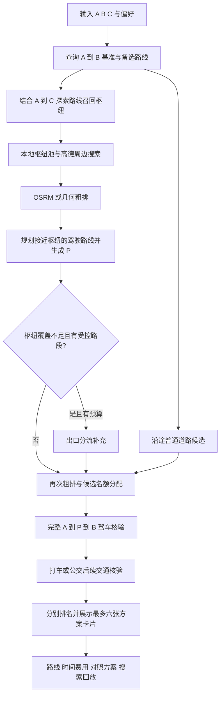

# 选点与推荐算法

本文按 2026-11-12 当前代码整理。快速使用见 [README](../README.md)，接口结构见 [API](API.md)。历史记录中的旧参数不作为当前配置。

## 4.1 输入、参数与时间口径

A、B、C 都应从地点搜索结果中选择，以取得坐标和公共交通需要的 `citycode`。所有业务地点使用高德 GCJ-02 坐标，经度 `lon` 在前、纬度 `lat` 在后。手动测算额外需要一个 P。

| 参数 | 当前默认值 / 范围 | 实际含义 |
|---|---|---|
| `max_detour_minutes` | 默认 120，0–120 分钟 | 司机相对原路线增加的总时间，**包括停靠** |
| `max_taxi_fare_yuan` | 默认 200，0–200 元 | P→C 的出租车估价上限，不限制公交票价 |
| `modes` | 默认 `taxi`、`transit` | 至少选择一种后续交通方式 |
| `priority` | 默认 `balanced`；另有 `time`、`cost` | 控制打车三档权重、公交偏好及同点位主推方式，详见 4.10 |
| `max_walking_m` | 默认 3000，0–5000 米 | 公交全程步行，包括到站、换乘及末段步行 |
| `max_transfers` | 默认 4，0–8 次 | 公交/地铁换乘次数上限 |
| `departure_time` | 可省略 | 省略则取当前中国时间；无时区输入按中国时间解释 |
| 到实际首乘站的步行上限 | 优先 300 米，最多 480 米 | 超出 300 米按 1.25 m/s、2.5 倍耗时增加评分惩罚；全程步行仍受 `max_walking_m` 限制 |

以上范围是后端模型允许的范围。公交按预计抵达 P 并停靠结束的时刻查询；驾驶时间按查询时取得的地图估算处理，不代表已接入未来出发时刻的交通预测。

## 4.2 一次自动推荐的整体流程



其中“召回”是找出可能有价值的位置，“粗排”是决定先算哪些位置，“精算”是调用正式路线接口检查限制。前两个阶段的估计不能直接成为正式推荐，但会影响排序和剪枝。由于名额和时间有限，粗排仍会影响哪些候选最终有机会接受核验，因此它不是无损的全量搜索。

## 4.3 第一步：建立统一司机基准

查询高德 A→B 驾车路线，从解析到的最多三条路线中选耗时最短的一条作为基准 `T_base`。所有候选都与这条基准比较，不因换了一条探索路线就放宽司机增加时间。

用于发现候选的其他 A→B 路线，还必须满足：

```text
备选路线耗时 ≤ T_base + max(0, 司机增加时间上限 − 10 分钟)
```

这给接近下车点、停靠和继续去 B 留出探索余量。例如上限为 30 分钟，备选路线最多比基准慢 20 分钟；上限不超过 10 分钟时，只保留与最快路线同耗时的路线。这是**探索路线的筛选规则**，具体 P 最终仍使用用户填写的完整上限核验。

另外查询最多两条 A→C 路线，用来发现朝乘客目的地方向的枢纽和道路。它们不会替代司机基准，也不要求司机最终沿 A→C 行驶。

## 4.4 第二步：枢纽召回与本地候选池

默认策略是 `CANDIDATE_STRATEGY=hub_first`。它把地铁站、公交站、停车场看作容易形成接驳的搜索锚点，再寻找锚点附近真正能通过路线核验的 P。

召回中心来自 C、各探索路线距离 C 最近的位置、路线实际驶出区域及沿线采样点。优先保留距司机探索路线不超过 `min(14 公里, max(8 公里, 司机增加时间上限分钟数 × 700 米))` 的中心；C 超出该走廊时放到后续轮询位置，仍可能作为补充中心入选。不同中心尽量相距至少 2 公里，总共最多六个；每个中心的查询半径是 5 公里。默认搜索停车场和地铁站，选择公交方式时再搜索公交站；只选打车时也可以利用地铁站附近道路，但不会因此执行公交规划或要求到站步行。

每个“中心 × 类型”先查 `.runtime/hub-pool.sqlite3`。这个 SQLite 候选池使用 R-tree 做空间检索，保存 POI、类型、有效期和已经查询过的范围。它有两个作用：重复路线可复用已有地点；查询范围已有有效覆盖时可省去一次周边接口请求。覆盖记录仅代表已执行过受页数限制的查询，并不证明该区域所有地点都已收集。

候选池默认有效期 30 天，最多保留 20,000 个枢纽和 2,000 条查询范围记录，按地图 Key 的哈希隔离数据。存储不可用时回退外部搜索；池内地点过期后需要重新查询。它是随使用积累的地点池，尚未建设全城市离线落客点库，也不保存“可合法停车”的认证。

查询结果按坐标和类型去重，地铁优先保留名称含“口”的具体出入口，再优先靠近司机走廊的位置，每个中心/类型最多收集 25 个地点；再按区域、类型交替保留覆盖，最多 96 个种子进入粗排。这样可以避免某个密集站点区域占满所有名额。

## 4.5 第三步：OSRM 与几何粗排各做什么

配置 `OSRM_BASE_URL` 后，适配器每批最多处理 80 个候选，以两张有方向的稀疏矩阵取得 A→B、A→P、P→B、P→C 的耗时，并取得 P→C 的距离。方向必须保留，因为单行道、掉头和匝道会让 A→P 与 P→A 不同。

OSRM 的粗估口径是：

```text
共同乘车粗估 = T_osrm(A→P)
司机额外驾驶粗估 = max(0, T_osrm(A→P) + T_osrm(P→B) − T_osrm(A→B))
乘客后续驾驶粗估 = T_osrm(P→C)
```

进入 OSRM 前，坐标从 GCJ-02 转为 WGS-84；高德查询和页面仍沿用 GCJ-02。请求不设置统一 `radiuses`，返回后再检查吸附距离：A/B/C 端点容差为 300 米，候选 P 容差为 250 米。单个 P 吸附超限或所需单元为空时，只回退该候选的几何估算；端点吸附超限、矩阵形状错误、接口不支持所需字段或整批超时等情况会使该批回退。OSRM 未配置时也能完成推荐。

几何回退使用 P 到探索路线的投影位置和横向距离估算共同乘车、绕行，再用 P→C 直线距离乘 1.35 估算后续路程，速度假设为 32 km/h。这些数值参与排序和部分剪枝，不能证明跨河、穿越隔离带或掉头可达。

打车粗排还使用内部车费近似 `12 + max(0, 后续公里数 − 3) × 2.4`，以便提前考虑时间与费用；它不会成为页面报价，也不用于正式费用上限判断。正式车费来自高德返回的出租车估价。

公交候选有独立的枢纽优先级，结合共同乘车、绕行估计和到 C 的距离按区域交替保留。地铁站以到 C 直线距离 ÷ 8.5 m/s + 300 秒估算后续耗时，公交站采用 ÷ 4.5 m/s + 420 秒，其他候选采用 ÷ 10 m/s + 360 秒。当前粗排不计算地铁运行矩阵，这些假设不是正式公交耗时；真实优劣留到后续公交接口核验。

粗排按绕行软预算分级：额外驾驶粗估加停靠不超过 `司机增加时间上限 × 1.5 + 180 秒` 的候选先轮询，其余排到队尾。这个阈值只影响核验顺序，不放宽正式司机上限。

两种粗排都不识别完整出口约束，日志标记 `constraint_aware=false`。矩阵失败不等于道路不通。当前精算入口会对“粗估额外驾驶＋预计停靠”超限的候选直接记录 `detour_limit`，并可能记录 `detour_bound_pruned`；这类事件可能发生在正式驾车请求之前，因此不能据此认定已通过完整路网验证。

## 4.6 第四步：把枢纽变成实际下车候选

对粗排后的最多 10 个枢纽分别规划 A→枢纽的高德驾车接近路线。沿路线末端向前尝试 15、60、150、250、350 米的位置，并优先考虑末端掉头前的同侧道路点；停车场还会尝试 POI 自身坐标。

首个候选允许位于枢纽直线距离 450 米以内，第二个限制在 300 米以内，并在附近匹配到具名、未被识别为受限的道路几何；每个枢纽最多生成两个不同候选。停车场自身坐标标为 `parking`，站点附近道路标为 `station_area`，停车场附近普通道路可标为 `roadside`。

这一步解决“地图上有一个站，但车能从哪里接近它”的问题。这里的 **450 / 300 米直线范围只是生成位置的条件**，与正式公交方案的 **480 米实际步行上限（优先 300 米以内）**是两次不同检查。站点中心坐标不会直接被认定为可停车位置。

与此同时，A→B 和 A→C 探索路线始终贡献普通道路候选。即使附近没有站点或停车场，道路点仍可用于打车推荐。采样会识别高速或快速路驶出后的具名普通道路，距其起点 1200 米内的候选粗分减 180 秒；路线超过 10 公里时，若 P 到 C 的直线距离仍大于 A 到 C 的 95%，粗分加 900 秒，减少早期或倒退点占用名额。这些调整无需额外地图请求，也不代表位置已经通过核验。

候选的交通方式通常跟随用户设置；部分距 C 较远的公交站种子在同时选择公交时优先按公交模式探索。站旁道路并不统一限定为只能乘公交。

## 4.7 第五步：覆盖不足时补充出口分流

满足以下条件且发现阶段剩余时间大于 2 秒时，默认策略才调用出口补充：枢纽道路候选中额外驾驶粗估不超过 `max(20 分钟, min(40 分钟, 司机增加时间上限 × 2))` 的候选少于四个，或选择公交但缺少站旁道路候选；同时司机探索路线包含高速、快速路或高架等受控路段。这里的“有效候选数”仍是粗排覆盖判断，不是正式绕行达标数量。

出口流程先确定沿行驶方向的搜索区域，再验证实际驶出。到达出口外普通道路后，分别规划去 B 和去 C 的路线，比较它们从起点开始的共同路段，对道路名去编号和后缀归一化，并结合距离、航向和道路层级判断；允许跨越400米以内短暂分叉后持续重汇合的路段，定位最终分流。在分流前、去 B 分支和去 C 分支上按近、中、远距离采样，得到可能兼顾司机与乘客的 P。不能把后面偶然再次重合的路段误认为共同前缀。

默认补充规模较小：最多八秒、最多六个出口查询中心、每条路线最多两个出口、最多六个补充候选，并复用已取得的 A→C 探索路线，不重复站点搜索。出口坐标只是寻找道路的锚点，不直接推荐高速主线、匝道或收费站上下客。

`CANDIDATE_STRATEGY=legacy` 保留此前流程供对照：含受控路段时以路线离 C 最近的位置 Q 及其前后出口为主线，结合 A→C 出口探索；没有受控路段时采用旧沿途候选流程。Q 用于定位区域，不是必须途经的下车点。新旧策略共用最终高德路线和后续交通核验。

## 4.8 第六步：分配名额并核验完整司机路线

枢纽、道路与出口候选再次粗排后，统一分配最多 24 个初始精算名额，其中普通道路最多预留 6 个，某一来源不足时由其余候选回填。候选身份包含 P、接近点和出口约束；相同坐标但出口约束不同，不会在预选时混为一个候选。

通过粗估剪枝并进入完整核验的候选，重新请求高德经停路线：

```text
普通枢纽/道路候选：A → P → B
带出口约束的候选：A → 接近点 → 出口外道路 → P → B
```

正式核验使用连续路线，检查 P 附近道路几何、经停连接和到 P 的耗时；有出口约束时还检查沿行驶顺序实际经过接近点、出口区域和 P。到 P 的共同乘车时间根据该连续路线的路段耗时及 P 在路段内的进度估算，并非独立查询 A→P 后任意拼接。

P 附近须匹配 5 米内的具名道路信息，识别为高速、快速路、匝道、高架、桥隧、收费站等受限位置时淘汰。普通国道、省道可以进入核验；当前规则也不因距公交站台 30 米、转弯/掉头节点 50 米以内就自动排除。道路识别依赖地图名称、导航说明和轨迹，不足以判断道路侧、禁停标线、桥上桥下或实际路缘条件，真实候选仍为 `unverified`。

司机时间按以下方式计算，所有 T、S 均以秒计：

```text
S = 普通道路/站旁 90 秒；停车场自身候选 180 秒
额外驾驶 = max(0, T(A→P→B) − T_base)
司机增加时间 = 额外驾驶 + S
司机经停总耗时 = T(A→P→B) + S
司机增加时间 ≤ max_detour_minutes × 60 才通过
```

`driver_route.duration_s` 是纯驾驶耗时，不含停靠；`driver_detour_s` 包含停靠。卡片和行程详情中的“司机总时间（含停靠）”为 `driver_route.duration_s + stop_duration_s`，表示完整 A→P→B 行程。由于所有自动候选都计入正的停靠时间，0 分钟增加上限不会返回候选。

## 4.9 第七步：分别检查打车和公共交通

**打车**查询 P→C 的高德驾驶路线和出租车估价，在驾驶时间上增加固定 300 秒接车缓冲。费用必须已知、有效且不超过预算，未知价格不会按零元参与推荐。接车缓冲是五分钟的产品假设，未接入实时叫车、车辆供给或接单价格。

**公共交通**按“出发时刻 + A→P 共同乘车时间 + 停靠时间”查询 P→C 的公交/地铁方案。每条备选都需要独立通过以下检查，再从合格方案中按偏好选择：

1. 能解析出实际首乘公交站台或地铁入口；不能用任意附近站点或地下车站中心替代。
2. 单独调用步行接口计算 P 到该入口/站台的路径，真实步行距离不超过 480 米；超过 300 米的部分增加评分惩罚。
3. 步行轨迹起终点偏移均不超过 5 米，剩余微小偏移计入距离和时间；缺失距离、轨迹或必要接驳信息则拒绝该公交方案。
4. 用核验后的接驳替换原方案首段步行，重新计算全程步行；全程步行和换乘次数均不超过用户上限。
5. 若新接驳比原首段慢超过容差，拒绝复用原时刻方案：首乘地铁容差为 120 秒，普通公交为 30 秒。其余情况只保守加时，不因步行变短就擅自提前公交到达时间；此容差并不保证能赶上实际班次。

例如 P 距某地铁站中心直线 180 米，但到实际入口要绕行 420 米，该公交方案可进入缓冲带，但超出 300 米的 120 米会额外增加 4 分钟评分惩罚；如果同一点的打车满足限制，打车可以保留。只选择打车时，不要求公交入口或 300 米接驳数据。

乘客时间统一为：

```text
下车后耗时 duration_s：
  打车 = 300 秒接车缓冲 + T(P→C 驾驶)
  公交 = 核验接驳后的完整公交方案耗时

乘客全程 total_duration_s = shared_ride_s + stop_duration_s + duration_s
预计到达 arrival_at = departure_at + total_duration_s
```

因此，卡片上的“下车后耗时”和“乘客全程”不是同一指标。公共交通详情按实际顺序列出到站步行、公交/地铁线路、方向、上下车站、站数、换乘和末段步行；缺失信息不会自行补造。

自动候选还支持直接步行：P 到 C 直线距离不超过 800 米时尝试真实步行规划，实际步行不超过 `min(1200 米, max_walking_m)` 才可返回 `direct_walk=true` 的零费用方案。它不含五分钟接车缓冲，也不计入打车或公交最低推荐数量；直线距离近不能替代步行路线核验。

## 4.10 第八步：打车评分与公交偏好

打车先执行司机增加时间和车费硬上限，再去掉被其他候选全面超过的方案：若另一方案的司机增加时间、乘客全程时间、车费都不更差，并且至少一项更好，则当前方案无需保留。随后按以下综合分升序排名：

所有时间单位为分钟。设 `d` 为含停靠的司机增加时间，先计算 `d_eff = d + 0.75 × max(0, d − 18)`，即超过 18 分钟的部分追加 75% 绕行惩罚，再按页面偏好切换权重：

| 打车偏好 | 综合分 |
|---|---|
| 均衡 `balanced` | `1.5 × d_eff + 乘客全程 + 1.8 × 车费` |
| 省时间 `time` | `1.5 × d_eff + 1.5 × 乘客全程 + 0.8 × 车费` |
| 省费用 `cost` | `1.2 × d_eff + 0.8 × 乘客全程 + 3.0 × 车费` |

综合分相同则优先双方合计耗时更短的方案，费用使用十进制精确计算。司机时间和乘客时间各自包含停靠，所以停靠对两个人的时间成本都会有贡献。附近不同位置只在司机增加时间、乘客全程时间和费用三项完全相同时去重（300米内，或同一具名道路2.5公里内）。已核验公交方案的首乘地铁线路集合不同时，豁免同名道路 2.5 公里去重。时间与费用各有优势的候选不会仅因同名或相近而被删除。

下面是**纯演算示例，不是真实行程结果**，假设三个方案均已通过硬约束，选择均衡偏好：

| 方案 | 司机增加 | 乘客全程 | 打车估价 | 综合分 |
|---|---:|---:|---:|---:|
| P1 | 10 分钟 | 60 分钟 | 20 元 | 1.5×10 + 60 + 1.8×20 = 111 |
| P2 | 15 分钟 | 55 分钟 | 15 元 | 1.5×15 + 55 + 1.8×15 = 104.5 |
| P3 | 8 分钟 | 50 分钟 | 30 元 | 1.5×8 + 50 + 1.8×30 = 116 |

上述三个方案的司机增加均未超过18分钟，尚未触发额外惩罚。均衡模式下P2综合分最低。省时间模式下P3综合分最低，为111。若候选司机增加时间至少90秒，且乘客全程与费用均不优于“随车到B后前往C”的同交通方式对照，则在最终短名单中置后；费用未知时不作此判断。

公交使用另一套评分。设 `t` 为乘客全程分钟加上到站步行超出300米的评分惩罚（`超出米数 / 1.25 × 2.5 / 60`，不修改实际到达时刻），`f` 为票价元，`w` 为全程步行公里，`n` 为换乘次数，`d` 为司机增加分钟：

| 公交偏好 | 当前排序口径 |
|---|---|
| 省时间 `time` | 分数为 `t − 地铁加分 + 0.35×d`；司机上限仍必须满足 |
| 省费用 `cost` | 仅保留不比当前最快可用公交候选多耗时 15 分钟以上的方案；方案分为 `f×1000 + t + w×2 + n×2`，候选分另加 `0.35×d`；候选先按票价、含步行惩罚的候选分、全程耗时、司机增加时间排序，再执行下述接近站点微调；混合模式公交不足两个时，补充未被全面超过的较慢方案 |
| 均衡 `balanced` | 分数为 `t + f×0.55 + w×8 + n×5 − 地铁加分 + d` |

地铁加分以评分分钟计：均衡模式首乘地铁减 5 分、公交后换乘地铁减 2.5 分；省时间模式分别减 3 分、1.5 分；省费用模式不加分。这是对准点性和乘坐体验的偏好，不修改实际耗时或到达时刻。

未知公交票价仍可展示为待估算，但费用评分会采用高惩罚值，不把它当作免费。公交候选的支配比较包含首乘类型、时间、费用、步行、换乘、司机增加时间和到站距离，避免普通公交仅凭接驳更短就淘汰地铁方案。

首乘类型相同、票价相同、换乘不增加、乘客全程相差不超过两分钟且评分相差不超过 2 分时，优先实际到站步行更短的方案；相同首乘入口和行程且各项比较指标完全相同的重复结果会收敛。每张公交卡片只保留按当前偏好选出的公交方案。

混合选择打车和公交时，先分别排名，再交错展示最多六张方案卡片，并为每种方式预留两个未被全面超过的合格方案；不足时不以全面较差或重复方案凑数。直接步行不计入打车或公交的最低数量。同一个下车点的打车、公交分别成卡；不同点不会在混合展示阶段因名称相同或相距不足300米而合并。各卡片保持自己的司机路线、到达时间、交通方式、费用和接驳数据，不跨点拼接。两种评分不能直接按数值比较。

推荐 `id` 继续标识原始候选，便于日志回放；卡片使用 `(id, suggested_mode)` 作为唯一键。卡片标题明确交通方式，同点位注明另有方案；同名但不同的附近点标注直线距离。选择、地图、详情和复制文案均跟随选中卡片。

## 4.11 搜索预算、提前结束与对照方案

候选按每批六个执行。完成至少两个批次（12 个候选）、取得至少四个不同司机行程且满足所选交通方式的最低数量要求时，可以提前结束。当前早停不再以覆盖全部区域为条件；其余候选会记录 `candidate_started` 和 `candidate_rejected(reason=detour_bound_pruned)`，这些事件不代表实际执行过完整路线查询。同一行程的打车和公交卡片不重复计数。该行为是有限预算下的剪枝策略，不保证覆盖全部可行下车点。

| 预算或限制 | 当前设置 |
|---|---|
| 枢纽发现阶段 | 38 秒总预算，并为探索、召回、接近和补充分配子预算 |
| 一次批量粗排调用 | OSRM 总等待上限 6 秒；单次 HTTP 请求超时 2.5 秒，两张矩阵整体等待上限 2.8 秒；发现阶段剩余预算还可能缩短等待 |
| 精算及对照阶段 | 最多 60 秒，同时受从规划开始约 105 秒的剩余预算约束 |
| HTTP 规划任务 | 最长等待 110 秒；超时取消任务 |
| 高德逻辑请求 | 单次规划最多 250 个未命中缓存且需新建的请求，限流重试另产生 HTTP 尝试 |
| 地图请求并发 | 每个 `AmapClient` 最多八个外部请求并发，同接口还受共享节流控制 |
| 结果有效提示 | 生成后五分钟提示重新计算，不代表五分钟内交通必定不变 |

内部阶段到期时尽量保留已完整核验的方案并附警告；HTTP 总超时可能返回 504。前端取消或修改输入后会中止旧请求，后端发现连接断开后取消计算。空结果表示已搜索范围内未找到满足条件的方案，不能推断所有道路都无解。

系统还尝试生成两个对照：从 A 直接前往 C，以及随车到 B 后再前往 C。前者要求起点道路条件足以支持换乘；后者把基准驾驶时间和 90 秒停靠计入乘客时间。对照同样查询后续交通并受相关约束检查，可能因城市编码、线路或预算不足而缺失。

默认枢纽搜索始终受召回中心、POI 页数和名额限制，**`search_complete=false` 是预期行为**，并不等于接口失败。`examined_candidates` 统计已启动精算的候选数，包含后来被拒绝或取消的候选；最终通过数要看结果与日志。即使所有入选候选都算完，也不能声称找到了全局最优下车点。

## 4.12 手动指定 P 的测试模式

进入 `/debug` 开发调试页，切换到“测试模式 · 指定下车点”后，直接计算 A→B、A→P→B 和 P→C，不经过自动召回、粗排与排名。它可以帮助比较“自己想到的 P”和自动推荐位置，查明某点是没有被召回，还是确实不符合限制。

当前手动模式测算的是**下车后打车**，固定计入 90 秒停靠和 300 秒接车缓冲，`combined_score` 使用所选 `priority` 对应的三档打车权重。超出司机时间或车费上限仍展示结果，通过 `within_detour_limit`、`within_taxi_fare_limit` 标记；道路核验未通过也保留测算并提示。P→C 查询失败时保留司机数据，乘客全程和费用可为 `null`，不会补造值。

手动模式需要真实地图 Key；演示模式返回 409。无法取得连续经停路线和到 P 的时间时会报错，手动结果不意味着该地点通过了自动推荐筛选或停靠合法性确认。

## 4.13 缓存、节流和失败回退

| 数据 | 本地位置 | 有效期 / 容量 |
|---|---|---|
| 枢纽 POI 与查询覆盖 | `.runtime/hub-pool.sqlite3` | 30 天，最多 20,000 个枢纽、2,000 条覆盖记录 |
| 高德地点与周边搜索、步行响应 | `.runtime/api-cache.sqlite3` | 24 小时 |
| 高德驾车响应 | 同上 | 180 秒 |
| 高德公交响应 | 同上 | 300 秒 |
| 地图响应缓存总容量 | 同上 | 最多 512 条、响应数据 32 MiB，按最近最少使用淘汰 |

只缓存成功响应，缓存键含接口、参数、Key 的哈希隔离信息和 TTL 策略；公交参数包含日期、分钟。命中不延长原有效期，旧版本 24 小时驾驶缓存会因策略键变化失效。同一次规划中的相同在途请求合并复用；缓存不可用时降级到进程内缓存。

高德同一接口在同一服务事件循环内共享请求节流，默认相邻请求启动间隔 0.12 秒，可用后端环境变量 `AMAP_REQUEST_INTERVAL_S` 覆盖；QPS 错误最多尝试三次并退避等待。因此，即使代码并发执行，完整推荐仍可能耗时几十秒乃至接近总预算。公交单独失败不会抹去可用打车方案；部分失败会返回不完整提示，关键基准路线失败则报错。

Linux 生产入口另有进程内请求限流：同一来源每分钟最多六次规划、60 次其他 API、180 次地图代理请求，全局每分钟最多 600 次 API/地图代理请求。这些保护尚不能替代多进程共享配额、用户认证或用户级费用管理。

## 4.14 OSRM 配置与实际使用状态

后端示例配置如下，OSRM 可留空：

```dotenv
CANDIDATE_STRATEGY=hub_first
OSRM_BASE_URL=http://127.0.0.1:5000
OSRM_DATA_VERSION=your-road-network-and-profile-version
AMAP_REQUEST_INTERVAL_S=0.12
```

OSRM 需要另行准备路网并运行服务，项目部署脚本不会自动安装它或下载路网。`OSRM_DATA_VERSION` 只是诊断标签，不会自动更新地图，也不代表高德实时路况。修改后端配置后需重启后端；修改前端 JS Key 则需重建前端。

根据仓库现有的 2026-11-09 验证记录，本机已接入广东路网 OSRM，并在两个固定测试点上取得 `engine=osrm` 的矩阵结果。随后一次真实自动推荐约 65.15 秒返回六个位置，但该次日志的粗排实际全部使用几何回退。因此，**“OSRM 服务连接成功”和“本次行程用到了 OSRM”需要分别确认**；不能据此宣称真实推荐性能或质量已经提升。

判断一次请求实际用了什么，查看 `candidate_coarse` 日志中的 `estimate.engine`、`missing_reason` 和 `network_version`。验证历史见 [项目上下文](../PROJECT_CONTEXT.md) 与 [Linux 部署说明](DEPLOY_LINUX.md)；历史健康检查和构建记录不等于此刻运行状态。

## 4.15 已知能力边界

当前已经实现完整的“搜索—筛选—核验—排名—解释”链路，但推荐点仍是待核实候选。高德 POI、具名普通道路和驾驶可达性不能证明私家车允许停靠；尚未接入道路侧/车道/路缘、实时禁停、入口开放和停车监管数据。不得在高速主线、匝道等禁停路段上下客。

此外，当前没有实时网约车订单和报价、公交实时候车、车辆 GPS 行驶进度或导航中的持续重规划。地图正式导航依赖真实轨迹；核验过程的诊断线可能使用端点连线回退，公交缺失城市编码、线路或入口时不编造方案。JS 地图代理已有路径和方法限制，生产入口也有基础限流，但公网使用仍需按实际来源和配额收紧访问。

离线测试与少量真实接口验证可检查计算规则和数据链路，不能替代道路现场核实，也不能证明在不同城市、长距离行程或高并发下的推荐质量。进一步评估需要用相同输入、约束及可比时间分别记录 `hub_first`/`legacy`、OSRM/几何的候选覆盖、成功率、耗时和实际调用量。
