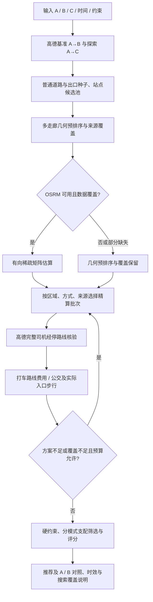

# AlongRoute 中途下车推荐整合方案

分析日期：2026-11-09。本文保留最初设计分析；随后已按用户确认将“枢纽召回为主、出口分流为补充”实现为默认策略，当前行为以 `docs/API.md` 和代码为准。OSRM 为可选接入，本轮没有部署服务或下载路网。

依据：用户提供的《网约车中途下车点算法 - Google Gemini》Markdown，以及当前 `backend/app`、相关测试、前端类型与展示逻辑。附件是聊天导出，提及的完整 `strategy_pseudocode.py`、MVP 脚本和部署手册并未随附件提供；其中“已验证”“已部署”的表述不能作为本项目运行证据。本文以实际代码为当前行为依据，历史 README 有部分过期描述。

**建议采用：现有多来源候选发现 + 可选 OSRM 有向矩阵预排序 + 高德完整路线精算 + 现有硬约束与分模式排名。** 先让 OSRM 参与排序并验证召回质量，再缩减精算数量；随后建设本地候选池，减少发现阶段的外部请求。

## 1. 当前实现到底在做什么

定义 A 为共同出发点，B 为司机终点，C 为乘客终点，P 为候选下车点。当前是出发前规划，不跟踪车辆实时位置。

| 阶段 | 当前行为 | 代码位置 |
|---|---|---|
| 接口 | `/api/recommend` 自动推荐；`/api/evaluate-dropoff` 手动测算；搜索日志及回放 | `backend/app/main.py`、`manual.py`、`search_replay.py` |
| 基准路线 | 查询高德 A→B，取返回路线中最快者作为统一基准；只保留处于探索预算内的其他路线 | `amap.py:310` 起 |
| 受控道路发现 | A→B 含高速/快速路/高架时，进入出口分流流程；逐路线找离 C 最近的 Q。Q 在受控段时找前后各最多三个出口；Q 在普通段时搜索普通道路 | `exit_discovery.py:126` 起 |
| 乘客方向补充 | 查询最多两条 A→C 探索路线，每条最多选择三个靠近 C 的不同出口区域，只用于发现候选 | `exit_discovery.py:192` 起 |
| 出口分流 | 先核验驶出路线，在真实普通道路落地点分别算去 B/C 的路线；比较连续共同前缀，在首次分流前、去 B 分支、去 C 分支采近/中/远候选 | `exit_discovery.py:74`、`:328` 起 |
| 站旁候选 | 在各分流方向代表点周围 5 km 搜索站点，最多选择 12 个站点组合算驾车接近路线，再找普通道路下客点 | `exit_discovery.py:397` 起 |
| 普通道路分支 | A→B 无受控段时，采用沿途道路、停车场、站点和 A→C 探索路线召回 | `amap.py:356` 起、`candidates.py:123` 起 |
| 候选预选 | 出口分支最多 48 个初始候选，其中普通道路最多预留 12 个；不同出口约束不合并。普通道路分支有独立的 48 个截断逻辑 | `preselection.py:22`、`amap.py:623` 附近 |
| 驾车核验 | 查询完整 A→P→B；有约束时为 A→接近点→出口外道路→P→B，核验顺序和 P 附近道路 | `amap.py:669` 起 |
| 后续交通 | 打车：P→C 高德驾车、出租车估价、固定 300 秒接车缓冲；公交：按预计抵达 P 并停靠后的时间查询，再单独核验到实际入口/站台的步行路线 | `amap.py:256`、`:647` 起 |
| 排名与呈现 | 打车与公交分别做可行性、支配关系及评分筛选，混合模式交错合并，最多六个点；附 A 直接出行、随车到 B 的对照 | `optimizer.py`、`amap.py:744` 起 |

必须延续的规则：

- 司机增加时间 = `max(0, 完整经停驾驶耗时 − 基准驾驶耗时) + 停靠时间`；普通道路/站旁停靠 90 秒，停车场 180 秒。当前上限默认 120 分钟，可设置为 0–120 分钟。
- 乘客全程 = `共同乘车时间 + 停靠时间 + 后续交通时间`；打车后续时间已包含 300 秒接车假设。
- 公交下车点到实际首乘入口/站台的核验步行距离必须 ≤300 m；另有全程步行与换乘数约束。找不到入口或核验路径不能算通过。
- 打车费用未知或超预算不能进入正式推荐；不要求打车点靠近地铁。
- 道路可达不等于可停车；当前候选保持 `stop_status=unverified`。
- 出口、分流和站点发现最多 38 秒；精算与对照最多 60 秒，并受全流程剩余时间约束；HTTP 总期限为 110 秒。普通道路分支的分阶段预算不同。
- 单请求实例最多发起 250 个未命中缓存的逻辑请求；限流重试可能产生更多真实 HTTP 尝试。不能把这个计数直接当成账户计费次数。

## 2. 附件中哪些内容应当吸收，哪些应当修正

| 附件提议 | 判断 | 整合办法 |
|---|---|---|
| 几何 → OSRM → 高德三级漏斗 | 值得采用 | OSRM 负责预估和优先级，高德负责最终路线与约束核验 |
| 本地出口/站点候选池 | 值得采用，且对当前瓶颈很重要 | 先做 SQLite 空间索引与按需补充，不为此新增 Redis/PostgreSQL |
| 只对少数地铁点调用高德 | 核验范围不足 | 入选点仍需核验完整司机路线；公交还需实际入口步行；打车需后续路线与费用 |
| `绕行距离≈2×垂距` | 只能作弱启发式 | 河流、隔离带、单行道、匝道会破坏近似；只能排优先级，不能据此判定可达或严格超限 |
| `D(P,C)≥0.95D(A,C)` 即倒退 | 不适合作硬筛 | 稍远但接入快线的枢纽可能更优；车辆倒退与到 C 的直线距离不是同一件事 |
| `near_highway_exit` 加 10 分钟/5 元 | 容易误判与重复计入 | 靠近出口不说明需额外下高速；现有完整路线已包含进出绕行。排队只增加有依据且未计入路线的残差；收费按实际差额 |
| GCJ-02 与 WGS-84“无损纠偏” | 表述不成立 | 做明确坐标转换、误差与吸附检查；转换不会证明道路侧、层级和行驶方向正确 |
| 汽车道路白名单直接裁剪 | 有拓扑信息丢失风险 | 保留限制转向关系及相关成员、节点标签，裁剪保留边界缓冲；不能只留下道路 way |
| CH 固定快 3–5 倍、常驻 250–400 MB、10–25 ms | 没有本项目测量支撑 | 可将 CH 作为矩阵用途的首个实验配置；实际版本、图数据、冷/热查询和并发压测决定选型 |
| 4 GB swap 保证不会 OOM | 不成立 | 预处理移到资源充足的机器；mmap/swap 不保证热点工作集和容器内存上限可满足 |
| 两张“极致省钱/极致省时”卡片 | 可以借鉴展示意图 | 只有按对应目标实际比较后的结果才贴相应标签；当前综合分第一不等于全程最快或最便宜 |
| 3.5 km 内自动共享单车 | 缺少真实可行性数据 | 暂不纳入首期；需骑行路线、禁行情况、车辆/停车可用性及独立费用估计 |

OSRM 官方默认建议使用 MLD，并把大型距离矩阵列为 CH 适用场景；这支持评估 CH，但不足以证明本项目 48–100 点的矩阵一定应选 CH。[官方项目说明](https://github.com/Project-OSRM/osrm-backend)

`--mmap` 是官方支持的文件映射加载方式；本文不据此承诺固定内存。需核验所选发行版本的参数与数据格式兼容性，不能默认附件里的旧版本号适合当前环境。[官方工具参数](https://github.com/Project-OSRM/osrm-backend/blob/master/docs/tools.md)

Osmium 默认补齐匹配对象引用的对象，并不会因为保留一条 way 就自动保留所有引用它的转向限制关系。官方示例显式包含 `r/type=restriction`；这就是原道路白名单命令需要修正的原因。[Osmium tags-filter 手册](https://docs.osmcode.org/osmium/latest/osmium-tags-filter.html)

高德普通距离测量的多起点单终点模式，可作为批量 P→C 的辅助，但不能将 P→A 反向使用为 A→P，也不能证明完整经停路线。“一个 HTTP 请求只扣一次额度”未在本次查阅材料中得到充分确认，成本应分别记录 HTTP 次数、计算点对数，并核对账户实际扣量。[高德路径与距离测量文档](https://lbs.amap.com/api/webservice/guide/api/direction/)、[计费说明](https://lbs.amap.com/pages/base_service_price)

## 3. 当前最值得优先解决的问题

**候选发现已经很昂贵。** 每个出口可能需要经出口到 B、出口外到 B、出口外到 C 三次驾驶查询，还要做站点搜索和站旁接近路线。OSRM 若只插在最终 48 个候选之后，只能降低精算成本，无法消除发现阶段开销。因而需要“先预排序接入，再把粗筛前移到出口/枢纽种子”的两步改造。

**缓存与实时口径不一致。** `map_cache.py:13–20` 将 POI、步行、驾驶、公交统一缓存 24 小时。返回结果虽然标记五分钟过期，所依赖的驾车路况仍可能来自数小时前。后续增加 `provider_fetched_at`、缓存年龄与端点独立 TTL；不能因重新生成响应而刷新底层数据时间。

**候选身份只在部分流程保持完整。** 出口预选使用 `(P, approach, exit)` 作为键，但普通道路分支按 P 合并，最终混合排序也按 P 合并交通方式。相同 P 不同到达路径可能具有不同共同乘车时间、公交查询时刻和绕行。应统一用执行路径身份键贯穿发现、精算、排名和回放；显示层只有在司机路线与时间一致时才能合并选项。

**现有时间和费用存在明确的估算边界。** 到 P 的时间由连续路线的路段时长按几何比例推算；不是独立的实时到点预报。`Route.fare_yuan` 当前解析的是出租车估价，不是高速费。代码没有实现额外过路费计分，也没有骑行模式。

**文档口径需要同步。** 当前 `optimizer.py` 已按司机增加时间、乘客全程时间和车费三维综合分排序，并按偏好切换权重。README、API 文档、界面解释和测试应保持一致。

## 4. 整合后的算法流程



### 4.1 保留候选覆盖，区分“种子”和“可核验下车点”

保留原路线普通道路、A→B 出口、A→C 出口、站旁道路、停车场五类来源。Q、收费站 POI、地铁站中心只是召回锚点，不是可直接推荐的 P。

第一阶段复用现有 48 个候选，OSRM 仅重排核验顺序，保持原数量及分组覆盖。这样可以独立评估它是否有用。

第二阶段把 `FocusedDiscovery.discover()` 拆成“收集种子 → 选择区域 → 展开出口/站点路线 → 生成 P”。用本地出口/站点池及粗估先选择少量区域，再执行当前高德分流逻辑。暂时保留一个覆盖补充批次，避免只挑靠近 C 的出口。种子阶段缺少道路层级信息时不可断言不可行。

几何走廊基于所有保留的 A→B 与 A→C 探索路线，按来源分别处理。不能用原 A→B 的狭窄走廊清空 A→C 候选。倒退判断使用对应路线进度与已知行驶方向，遇到回环、平行路和层级歧义保留给精算。

### 4.2 OSRM 接口：算需要的有向点对

新增 `osrm.py` 适配器及 `coordinates.py`。业务与高德坐标始终保留 GCJ-02；只在 OSRM 边界转 WGS-84，并记录原坐标、转换版本、吸附距离、数据版本与缺失原因。

无出口约束时需要：`A→B`、`A→Pi`、`Pi→B`、`Pi→C`。建议坐标表固定为 `[A,B,C,P0,...,P(N-1)]`，用两次 table：

```text
请求一：sources=0
        destinations=1;3;4;...;N+2
        annotations=duration,distance
请求二：sources=3;4;...;N+2
        destinations=1;2
        annotations=duration,distance
```

共返回 `3N+1` 个点对，而全矩阵是 `(N+3)^2`。N=50 时分别是 151 和 2809。两次本地 HTTP 是否更快仍应实测；小规模可保留全矩阵对照。不得用反向距离替代正向距离。配置容量时还要包含 A/B/C 和出口锚点，而非只数候选点；按锁定版本限制分批。

```text
预估绕行 = T_osrm(A,Pi) + T_osrm(Pi,B) − T_osrm(A,B)
后续打车粗估 = T_osrm(Pi,C)、D_osrm(Pi,C)
```

上述差分全部来自同一 OSRM 图和配置。不能拿两个 OSRM 分段时间减去高德基准时间，所得差值混入了提供方差异。

有接近点 U、出口外落地点 E 时，最终执行路线是 `A→U→E→Pi→B`。若要增强粗估，应补齐有向链的缺失点对；最初也可保留无约束粗估，但必须标记 `constraint_aware=false`，留给覆盖名额与高德核验。独立点对拼接不会自动保证中间转向、车道和连贯通行。

`null`、`NoTable`、`NoSegment`、超时、区域外、吸附异常均转为“本地估算不可用”，保留几何/覆盖后备次序，不能解释成高德必定无路。若启用 OSRM 的距离回退估算，必须标记为估算单元；首版建议关闭，避免误把直线补值当路网结果。返回矩阵应按 `sources`/`destinations` 的局部序号映射，不能继续套全矩阵下标。

OSRM Table 支持分别指定源和目标；时间单位为秒，距离为米，距离是最快路线对应的距离，可达性缺失时可返回 `null`。以上为官方语义；具体发行版及算法是否支持所需字段要做启动能力探测。[OSRM HTTP 文档](https://project-osrm.org/docs/v26.4.0/http)

### 4.3 预估阶段选顺序，精算阶段定结论

首版不要把 OSRM 静态超时估计作为严格超限淘汰依据。它与高德路网、实时拥堵、收费偏好和实际出口约束都可能不同，也不是可靠的高德下界。

预选使用打车粗估榜、公交枢纽榜与覆盖名额的并集。公交预选不能只按 P→C 的汽车耗时，否则会错杀地铁优势点。没有本地公交网络时，枢纽榜只结合到 P 时间、入口距离及区域覆盖，不假造真实公交成本。

初始实验参数：每批 8 个，优先完成 16–24 个，效果足够且预算允许时再扩展，最多保留现有 48 个初始名额。每批保留普通道路、不同出口、不同分支与交通方式的机会；不是全局粗估前 16 名独占。只要截断未核验候选，设置搜索不完整。16–24 是待回放验证的参数，不是已证明充分的数量。

候选按以下顺序精算，尽早终止无效分支：

1. 高德完整经停司机路线，实际驶出顺序、道路可用性、绕行加停靠硬上限。
2. 通过后算 P→C 打车路线与费用，或按到 P 时间查询公交。
3. 公交逐个备选核验实际首乘入口步行 ≤300 m，再检查总步行、换乘数与接驳时间一致性。
4. 保存每个完整核验的选项；失败一个交通方式不影响另一个已通过的方式。

公交返回行程通常已含接驳步行；当前代码会替换并校正首段步行，不能再机械添加“步行 + 4 分钟等待”。只有确认未包含的缓冲才可加一次。打车 5 分钟等待继续标注为假设。

### 4.4 评分先兼容现状，再逐步统一参数

当前打车目标按偏好切换权重，所有时间采用分钟：

```text
S_balanced = 1.5 × 司机增加时间 + 乘客全程时间 + 1.8 × 后续打车估价
S_time = 1.5 × 司机增加时间 + 1.5 × 乘客全程时间 + 0.8 × 后续打车估价
S_cost = 1.2 × 司机增加时间 + 0.8 × 乘客全程时间 + 3.0 × 后续打车估价
```

先执行司机绕行、打车费用硬上限，再在司机增加时间、乘客全程时间、车费三维上排除被全面支配的方案，最后按综合分排序。停靠同时影响司机和乘客，分别计入双方时间是当前目标的含义，不是同一人的重复计时。

公交继续保留均衡/时间/费用偏好，以及省费用时相对当前最快可行公交候选最多多 15 分钟的规则。不要用打车分数和公交分数直接跨榜比较。

如后续产品要统一为广义费用（元），可使用：

```text
J = v_driver × ΔT_driver
  + v_passenger × (T_shared + T_stop + T_ride + γ_walk×T_walk + γ_wait×T_wait)
  + λ_fare × F_onward + λ_toll × ΔToll
```

其中各时间必须互斥，单位为分钟，时间价值为元/分钟。`T_ride/T_walk/T_wait` 是后续交通拆分，不能再叠加已含这些成分的 `duration_s`。若取双方时间价值 1/3 元/分钟、费用权重 1、不额外放大等待且暂不含过路费，则 `3J` 与现有打车分数一致。这给后续标定留下兼容起点。

过路费须新增独立 `toll_yuan` 字段，解析基准与完整经停路线费用后计算差额。未知为 `null`，不得填零或固定五元；未取得数据前只展示“未知”，不悄悄改变原评分。`near_highway_exit` 不参与收费或固定时间加罚。

保留最多六个候选和 A/B 对照。可从已完整验证的集合选出“综合推荐”“已核验方案中最快”“已核验方案中后续费用最低”；同一方案可以承载多个标签，不硬凑两张不同卡片。首段顺风车分摊价尚未建模，因此只能宣称“后续费用”，不能宣称完整行程总支出最低。

### 4.5 缓存、降级与预算

| 数据 | 建议首期策略（待实测调整） |
|---|---|
| POI 与静态候选信息 | 沿用 24 小时响应缓存；本地候选库保留来源、更新时间、地区与入口身份，过期补查 |
| 步行路径 | 可沿用 24 小时，保留路径核验时间；不表示入口此刻必定开放 |
| 高德驾车路况 | 建议 1–3 分钟；基准与候选使用相近的数据时间，超过容差时刷新基准并重算差分 |
| 公交 | 建议 1–5 分钟，键保留实际出发日期/分钟；不得为提高命中率任意取整发车时间 |
| OSRM 矩阵 | 由路网版本、profile、坐标与吸附约束共同决定，换图/换配置即失效 |

POI 候选池先用 SQLite R-tree 或空间网格索引，区分 `HubSeed` 与 `DropoffCandidate`。保存地铁具体入口、公交站台、普通道路落点及出处。首次未命中时按预算调用高德；不要假设当前 512 条 API 缓存就能覆盖全省候选库。

降级链：OSRM 不可用 → 当前几何/来源覆盖预选 → 高德完整核验；高德部分失败 → 只返回已完成核验的结果并标记不完整；全部关键路线失败 → 返回地图服务错误。不能让“几何兜底”变成输出虚构车费、公交班次或可停车结论。

保留当前 110 秒总期限作为首期外层保护，统一用绝对截止时间向子阶段传递剩余预算。给对照方案预留时间和调用名额，避免所有预算在候选精算阶段耗尽。后续在本地候选池稳定后，再以 20–30 秒端到端 P95 为优化目标；该目标尚无当前实测支持。

调用量按阶段核算：`基准/探索 + 发现 + 司机核验K + 打车核验K_t + 公交查询K_p + 入口步行W + 对照 + 重试`。目前同端点请求启动至少相隔 0.55 秒；单端点若有 40 次真实请求，启动跨度就至少约 21.45 秒，另有响应时间。降低 API 数量与发现成本比承诺 OSRM 单次十几毫秒更有意义。

## 5. 对代码的具体改造位置

以下是拟新增或修改项，不表示已经实现。

| 文件/模块 | 改造职责 |
|---|---|
| 新增 `backend/app/coordinates.py` | 显式坐标类型/转换边界，避免重复转换；误差检查 |
| 新增 `backend/app/osrm.py` | 异步连接复用、能力探测、有向矩阵映射、空值/超时处理、路网版本和吸附信息 |
| 新增 `backend/app/coarse_routing.py` | 统一 OSRM/几何估算结果；候选和出口种子预排序，不承担最终可行性判断 |
| 新增 `backend/app/hub_store.py` | 本地出口/站点/入口候选池与空间查询，按需刷新 |
| `preselection.py`、`candidates.py` | 统一身份键；覆盖名额 + 分模式粗估榜；记录每次预选原因 |
| `exit_discovery.py` | 分离种子召回与路线展开，支持在昂贵的出口分流计算之前做优先级选择 |
| `amap.py` | 拆出可复用的单候选精算器；替换调度顺序；保留连续路线与真实入口核验；减少大函数内嵌职责 |
| `map_cache.py` | 端点独立 TTL、数据获取时间、缓存年龄与版本迁移；现存旧长 TTL 数据需要失效处理 |
| `models.py`、`optimizer.py`、`manual.py` | 明确估算来源；过路费独立字段；自动/手动共用时间费用口径；保持首期排名兼容 |
| `search_log.py`、`search_replay.py`、`CandidateReplay.vue` | 增加矩阵结果/缺失原因、预算阶段、预估与实际误差；回放白名单同步更新 |
| `frontend/src/lib/api.ts`、`App.vue` | 展示数据时效、后续费用口径、粗估与已核验状态、失败/截断原因；相同 P 的不同司机路线不得错误合并 |

建议内部估算字段：`engine`、`network_version`、`constraint_aware`、`estimated_detour_s`、`estimated_onward_s`、`estimated_onward_m`、`snap_distance_m`、`missing_reason`。不将这些估算写入代表精算结果的字段。

建议增加 `search_status`（完成当前候选池/预算截断/服务降级等）与分阶段计数，同时保留 `search_complete` 兼容前端。“完成当前候选池”仍不表示全局最优。启动候选数、完成司机核验数、完成全部选项数分别记录，避免将已启动任务当作已完成。

## 6. 2 核 2 GB 的落地选择

2 核 2 GB 来自附件的目标条件，本次未测量当前服务机器资源，也未核验 OSRM 是否已在系统其他目录部署。

首期保持 FastAPI + SQLite，OSRM 作为可关闭的本地独立服务，不新增数据库常驻服务。建议先用一个目标城市群数据集验证，成功后扩展广东。构建在资源充足的机器完成，固定镜像版本或 digest、地图日期、profile 哈希，构建与运行使用兼容版本。

提取数据时保留转向限制、通行权限、单行、屏障、必要轮渡和完整引用关系，边界留缓冲并检查跨边界路由。汽车图不承担骑行/步行判断。港澳跨境路线单独视为未覆盖业务能力，不能因为裁剪框包含港澳就默认车辆可通行。

采用 CH + mmap 做首轮矩阵实验，同时保留 MLD 对照；不要先人为拉高高速车速来强迫它匹配高德。先测静态图与高德结果的排序偏差，再判断是否需要区域 profile 标定。OSRM 只监听本机或私网，不需要公开 5000 端口。

验收测量：预处理峰值内存、OSRM 启动与热查询内存、整机可用内存、page cache/cgroup 内存、swap 活动、冷启动和热查询 P50/P95、并发 1/2/4 下的端到端延迟。超过资源预算时缩小区域或独立部署，不能用固定 600 MB 限制代替容量验证。

## 7. 实施顺序与验收

| 阶段 | 交付 | 验收与回退 |
|---|---|---|
| P0：口径与观测 | 分阶段 API/时间统计、缓存时效、统一路径身份、同步文档 | 不改变既有硬约束和评分；新旧行为差异可解释 |
| P1：OSRM 影子估算 | 对现有候选计算 OSRM 分数但不改变结果，补录矩阵与吸附数据 | 对照精算耗时/费用及各分组召回；关闭开关即回到原流程 |
| P2：预选和渐进精算 | 先重排 48 个，再验证 16–24 个起步、按需扩展 | 保持参考最优方案召回；减少真实 HTTP 调用和总耗时，局部失败能回退 |
| P3：发现阶段降本 | 候选库、出口种子粗筛、按需展开分流路线 | 发现阶段调用量下降，A→C 与普通道路覆盖不消失 |
| P4：产品扩展 | 实际过路费、广义费用参数与明确目标标签；骑行另立能力 | 有对应数据与验证后才启用，不改变未知值语义 |

评估使用同一批 A/B/C、偏好和冻结的高德响应。现有日志可分析流程和耗时，但没有全部未核验候选的真实结果，不能单靠旧日志证明召回率。需另采集有预算的参考样本，并明确参考仅是更宽候选池下的最优，不是全局真值。

建议至少覆盖：普通城市道路、广深/广佛等高速跨城、Q 在受控段/普通段、单行与高架辅路、跨河绕行、靠近省界、夜间公交、入口直线近但步行远、同一 P 不同出口路径、未知费用、0 分钟绕行限制、OSRM 部分空值/全失败。

建议试验门槛：固定样本下参考最佳可行方案进入精算的比例 ≥95%，硬约束无放宽；高德真实 HTTP 尝试数中位数比对照减少 ≥40%，同时报告 P95 延迟及无结果比例。数值是验收目标，尚未测得；若达不到，优先增加覆盖/精算名额或关闭截断，不为达到速度目标牺牲可行性。

需要新增的回归重点：非对称矩阵、两张表索引、坐标转换/重复转换、失联与吸附异常、路网版本失效、OSRM 只影响优先级、不同路径同 P 不合并、缓存老化后基准差分、司机绕行/停靠与乘客时间不重复、公交 300 m 约束、接口部分失败和预算取消。继续运行已有出口、预选、公交、打车、手动测算及回放测试。

初次分析阶段仅交付设计文档。后续实现及离线验证记录见 `docs/algorithm-upgrade.md`；尚未作真实行程质量或性能提升的实测结论。
